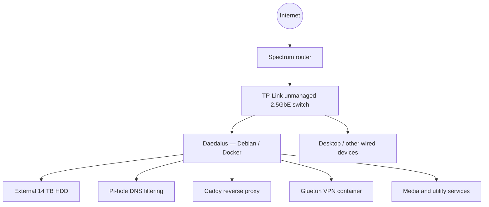

# Daedalus — Self-Hosted Linux Homelab

**A personal infrastructure project focused on Linux administration, containerized services, networking, and troubleshooting.**

## Overview

Daedalus is my ongoing homelab, built around a repurposed Lenovo ThinkCentre M920q running Debian 13. I started this project to learn by deploying and maintaining real services rather than working exclusively in classroom or simulated environments.

My computer science coursework emphasized software, databases, and file systems. Building Daedalus introduced me to the infrastructure those applications depend on: networking, DNS, remote access, storage, service management, and reliability.

This repository documents what I've built, problems I've encountered, and the networking skills I plan to develop next. It is a project write-up, not a public copy of my production configuration.

## Current hardware and software

| Component | Current setup |
| --- | --- |
| Compute | Lenovo ThinkCentre M920q, Intel Core i5-8500T |
| Operating system | Debian 13 (Trixie) |
| Container platform | Docker |
| Home router | Spectrum-provided router |
| Switch | TP-Link TL-SG105-M2, unmanaged 5-port 2.5GbE |
| Storage | 14 TB Toshiba HDD in an external USB enclosure, mounted on the Debian host |
| Client workstation | Arch Linux desktop, also used to administer the server |

I deliberately reused existing equipment to gain hands-on experience with a modest budget.

## Current network architecture

The following is a **simplified logical overview** of my existing setup. It does not show private network addresses, public endpoints, credentials, or every connection.

*The diagram highlights major components and their roles rather than every network interface or dependency.*

## Services I've deployed

| Service | What I use it to learn or accomplish |
| --- | --- |
| **Pi-hole** | DNS resolution, filtering, and diagnosing name-resolution problems |
| **Caddy** | Reverse proxy configuration and service access |
| **Gluetun + qBittorrent** | VPN-based container networking and understanding traffic paths |
| **Jellyfin** | Self-hosting, client/server communication, and media playback |
| **Navidrome** | Running and maintaining another web-accessible service |
| **Sonarr, Prowlarr, and Shoko** | Container integration, paths, service connectivity, and application administration |

I manage these services using Docker and have learned to investigate behavior through configuration, logs, permissions, network settings, and service health.

## Practical work and troubleshooting

### 1. Building and administering a Debian server

I repurposed a small desktop as a dedicated Linux server, configured Ethernet networking, attached external storage, and deployed services in Docker. Running these services long-term has taught me to distinguish application problems from host, filesystem, DNS, and networking issues.

### 2. DNS and reverse proxy configuration

Deploying Pi-hole and Caddy helped me understand how clients find services, how requests are routed, and how to troubleshoot failures across multiple layers of a self-hosted system.

### 3. VPN-connected containers

I configured a containerized VPN arrangement with Gluetun and a dependent application. This exposed me to Docker networking, routing behavior, and the importance of verifying that applications communicate through the intended network path.

### 4. Diagnosing external-storage instability

An external hard-drive enclosure experienced intermittent I/O and USB connection problems. I investigated logs, USB driver behavior, disk health information, and filesystem integrity; adjusted the USB storage driver behavior; and performed filesystem checks during recovery. This reinforced the importance of isolating problems, validating assumptions, and checking system health after making changes.

### 5. Organizing persistent storage

I maintain separate areas for downloads and the media library on the same filesystem. Working with hardlinks, file permissions, and container mounts has strengthened my understanding of Linux storage and how containerized applications interact with host resources.

## What I want to learn next

My existing TP-Link switch is unmanaged and my Spectrum router provides limited opportunities for advanced networking experiments. I want to build an isolated, manageable network lab alongside my existing server to learn:

1. **VLANs and segmentation** — separate trusted clients, server services, guest devices, and lab workloads.
2. **Routing and firewall policies** — test inter-VLAN communication, access rules, and VPN behavior.
3. **Managed switching and Wi-Fi** — configure tagged/untagged ports, trunks, wireless SSIDs, and secure guest access.
4. **Network diagnostics** — measure throughput and latency and inspect packets with tools such as `iperf3` and Wireshark.
5. **Industry-standard fundamentals** — study the Cisco CCNA curriculum and practice network design, addressing, and troubleshooting.

I plan to document the resulting topology, configuration decisions, tests, failures, and lessons learned here. My goal is to transition from primarily software-based homelab experience into practical network and infrastructure engineering skills.

## Project status

**Active, ongoing personal lab.** The existing server and services are operational; the managed networking lab above is a proposed next phase, **not equipment I already own or projects I've completed**.

## Security and publishing notes

This repository is intentionally documentation-focused. It does not include real credentials, API keys, passwords, VPN configuration files, sensitive logs, internal IP addressing, externally reachable hostnames, or unredacted screenshots. Configuration examples may be added later after review and sanitization.
